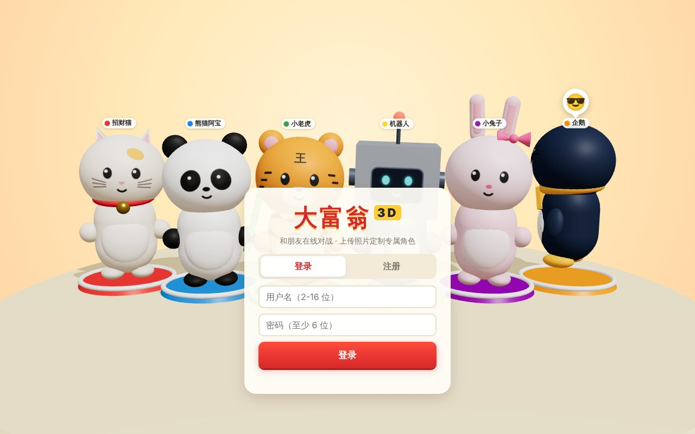
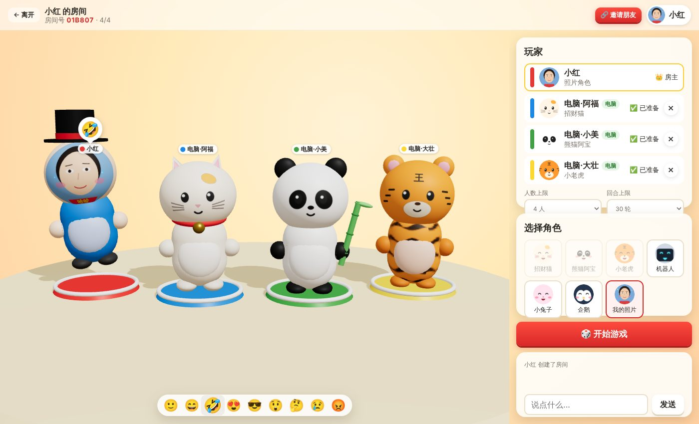
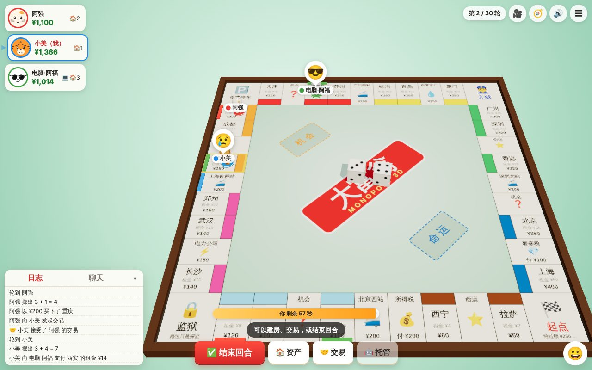
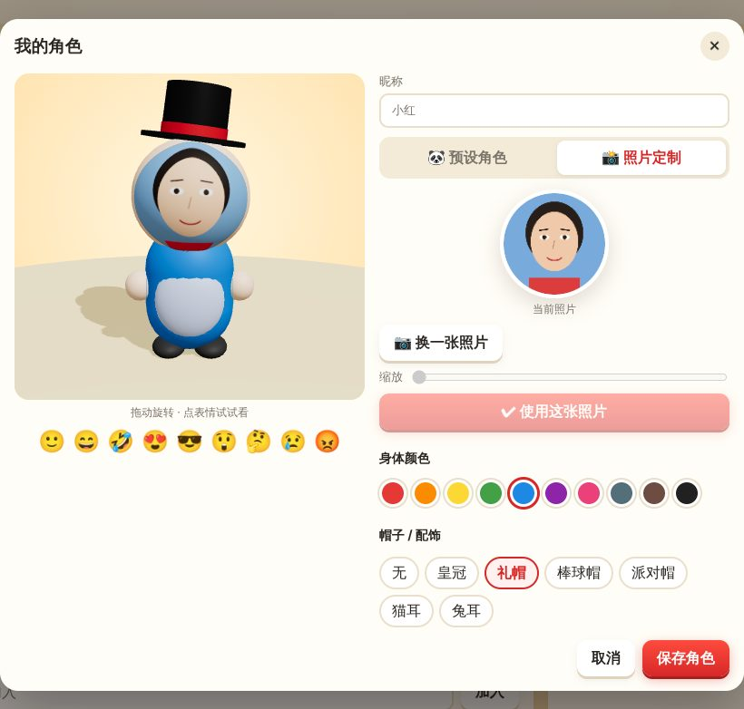
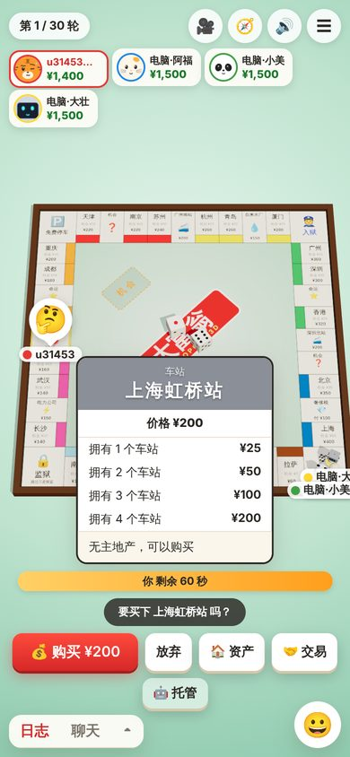
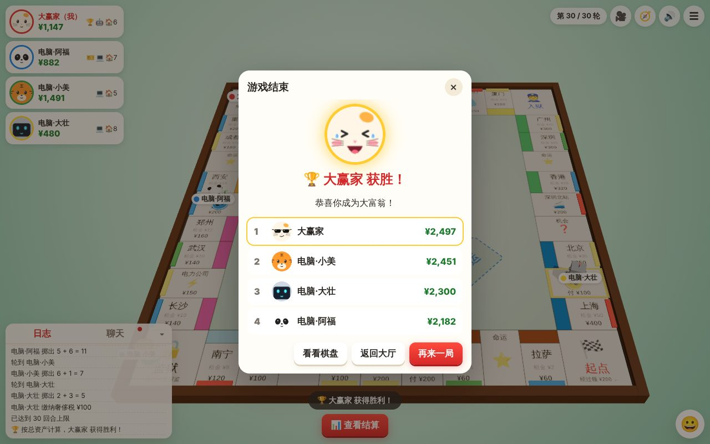
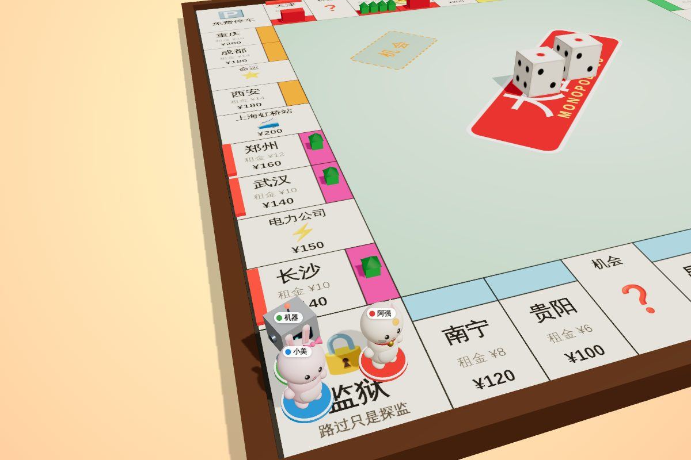

# 🎲 大富翁 3D（Monopoly 3D）

一个**用浏览器就能玩的联网 3D 大富翁**：注册登录后创建房间，把邀请链接发给朋友，2～6 人在线对战。
6 个 Q 版 3D 角色，9 种表情，还可以**上传自己的照片**定制专属角色（照片做脸，自选身体颜色和帽子）。



| 等待房间（3D 展示台） | 对局 |
| --- | --- |
|  |  |

| 照片定制角色 | 手机竖屏 | 结算 |
| --- | --- | --- |
|  |  |  |



## ✨ 功能

- **网页即玩**：不用安装，电脑、手机浏览器都能打开；账号注册 / 登录（密码 scrypt 加盐存储）。
- **联网对战**：大厅房间列表、房间号 / 邀请链接加入、准备、房主开局，2～6 人；服务端权威判定，所有人画面实时同步。
- **3D 棋盘**：Three.js 渲染的立体棋盘、会翻滚落定的骰子、角色一格一格跳着前进、房子 / 酒店 / 归属标记 / 抵押遮罩，可拖动旋转缩放视角。
- **6 个预设角色**：招财猫、熊猫阿宝、小老虎、机器人、小兔子、企鹅，每个都有自己的造型和配饰。
- **角色表情**：开心、大笑、喜欢、得意、惊讶、思考、难过、生气……
  - 游戏事件会**自动触发**表情和动作：买地开心跳起来、付高额租金气得发抖、入狱生气、收租得意转圈；
  - 也可以点右下角 😀 **手动发表情**，所有玩家都能看到头顶的表情气泡；
  - 左上角玩家头像也会同步显示表情。
- **照片定制角色**：上传照片 → 拖动 / 缩放裁剪（有“眼睛对齐线”）→ 照片贴到 3D 角色的脸上；可选 10 种身体颜色、皇冠 / 礼帽 / 棒球帽 / 派对帽 / 猫耳 / 兔耳。照片角色同样有表情（墨镜、眼泪、腮红、爱心、怒气符号等特效）。
- **完整规则**：买地、收租（同色翻倍）、均衡建房、酒店、车站、公用事业、机会 / 命运卡、监狱、抵押 / 赎回、破产清算、玩家之间交易。
- **电脑玩家与托管**：房主可以添加电脑玩家；60 秒不操作自动托管，掉线后电脑代打，重新打开网页自动回到对局。
- **回合上限**：可设 20 / 30 / 50 / 80 轮或不限，到达上限按总资产排名。
- 聊天、游戏日志、音效（WebAudio 合成，无需音频文件）、手机竖屏适配。

## 🚀 快速开始

需要 [Node.js](https://nodejs.org/) 18 或更高版本。

```bash
npm install
npm start
```

打开 <http://localhost:3000>，注册账号即可开始。想一个人先试试，点大厅里的 **“🤖 和电脑练习一局”**。

## 🌐 和朋友联机

服务器启动后，其他人用浏览器访问这台服务器的地址就能一起玩：

- **同一个 Wi-Fi / 局域网**：让朋友打开 `http://<你电脑的局域网 IP>:3000`（例如 `http://192.168.1.23:3000`）。
- **不在一起**：把项目部署到任意能跑 Node.js 的云服务器或平台（腾讯云 / 阿里云轻量服务器、Render、Railway、Fly.io 等），然后把网址发给朋友。
- 进入房间后点 **“🔗 邀请朋友”** 复制邀请链接，朋友打开链接登录后会直接进入你的房间。

### 用 Docker 部署

```bash
docker build -t monopoly-3d .
docker run -d -p 3000:3000 -v monopoly-data:/data --name monopoly monopoly-3d
```

### 配置

| 环境变量 | 默认值 | 说明 |
| --- | --- | --- |
| `PORT` | `3000` | 监听端口 |
| `DATA_DIR` | `./data` | 账号数据（`users.json`）和头像图片的保存目录 |

> 账号和头像会保存在 `DATA_DIR` 中；房间和对局保存在内存里，服务器重启后进行中的对局会丢失。
> 如果部署在 Nginx 等反向代理后面，记得开启 WebSocket 转发（`Upgrade` / `Connection` 头）。

## 🎮 玩法

1. 轮到你时点 **🎲 掷骰子**，角色会自动前进。掷出双数可以再掷一次，连续三次双数会“超速入狱”。
2. 停在无主地产上可以**购买**；停在别人的地产上要**付租金**。
3. 集齐同一颜色的全部地产后租金翻倍，并且可以**建房**（需均衡建设），4 栋房后升级为**酒店**。
4. 缺钱时可以**卖房**（半价）或**抵押**地产；资金为负又筹不到钱就只能**宣告破产**，资产归债主。
5. 在自己的回合可以向其他玩家发起**交易**（现金 + 地产）。
6. 只剩一名玩家，或到达回合上限时按**总资产**（现金 + 地产 + 房屋）决出胜者。

点击棋盘上任意格子可以查看地产卡（价格、各级租金、主人），自己的地产还能直接建房 / 抵押。

## 🗂 项目结构

```
server/
  index.js        启动入口
  app.js          Express（注册登录、资料、头像上传 API、静态文件）+ Socket.IO
  auth.js         账号、会话令牌、头像保存
  rooms.js        大厅 / 房间 / 准备开局 / 实时同步 / 托管 / 超时 / 断线重连 / 聊天表情
  store.js        JSON 文件存储
  game/
    engine.js     规则引擎（纯逻辑，服务端权威）
    bot.js        电脑玩家 AI（也用于托管）
    cards.js      机会卡、命运卡
shared/           服务端和浏览器共用：棋盘数据、角色与表情定义、规则判断
public/
  index.html, css/style.css
  js/
    main.js       登录、大厅、房间界面
    gameui.js     对局 HUD：操作按钮、地产卡、资产、交易、日志聊天、结算
    editor.js     角色编辑器：预设角色 / 照片裁剪上传 / 身体颜色 / 帽子
    three/
      game3d.js   对局 3D 场景与事件动画队列
      board.js    棋盘（画布贴图）、房屋、归属标记
      character.js 3D 角色模型与表情动作
      faces.js    表情绘制（预设角色五官、照片特效）
      dice.js     3D 骰子
      stage.js    角色展示台（登录页、房间、编辑器预览）
test/             规则引擎单元测试 + 多客户端联网集成测试
```

## 🧪 测试

```bash
npm test
```

包含规则引擎测试（掷骰、租金、建房、监狱、破产、交易、电脑玩家完整打完多局、回合上限）和联网集成测试（注册登录、头像上传校验、三名玩家建房开局同步、表情聊天广播、超时托管、断线重连、退出认输、玩家交易）。

## 🛠 技术栈

Node.js · Express 5 · Socket.IO 4 · Three.js · 原生 ES Modules（无需前端构建）
